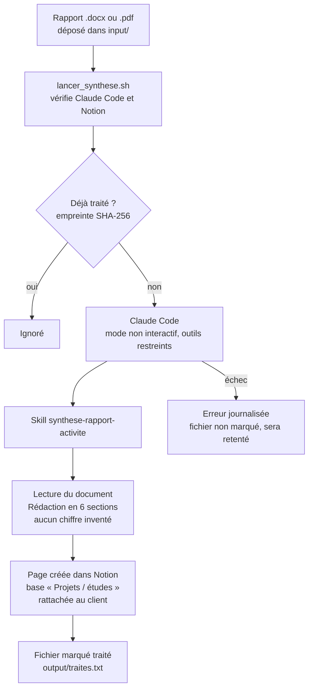

# Flux de traitement et planification

## Le flux en un coup d'œil

```
   ┌─────────────────┐
   │  Un rapport est │   .docx ou .pdf
   │  déposé dans    │   déposé à la main, ou par la tâche planifiée
   │  input/         │
   └────────┬────────┘
            │
            ▼
   ┌─────────────────────────┐
   │ lancer_synthese.sh      │  vérifie Claude Code et la connexion Notion
   └────────┬────────────────┘
            │
            ▼
      ╔═════════════════╗
      ║ Déjà traité ?   ║  comparaison de l'empreinte SHA-256
      ╚══╦═══════════╦══╝  avec output/traites.txt
     oui ║           ║ non
         ▼           ▼
   ┌──────────┐  ┌──────────────────────────┐
   │ Ignoré   │  │ Claude Code              │  mode non interactif
   └──────────┘  │ skill :                  │  outils restreints
                 │ synthese-rapport-activite│
                 └────────┬─────────────────┘
                          │
                          ▼
                 ┌──────────────────────────┐
                 │ Lecture du document      │
                 │ Rédaction en 6 sections  │  aucun chiffre inventé
                 └────────┬─────────────────┘
                          │
                          ▼
                 ┌──────────────────────────┐
                 │ Page créée dans Notion   │  base « Projets / études »
                 │ + rattachée au client    │  sous « H Factory – Démo »
                 └────────┬─────────────────┘
                          │
                          ▼
                 ┌──────────────────────────┐
                 │ Fichier marqué traité    │  output/traites.txt
                 │ Tout est journalisé      │  output/journal.log
                 └──────────────────────────┘
```

### Même schéma en Mermaid



## Ce que fait le script

`scripts/lancer_synthese.sh` :

1. Vérifie que Claude Code est installé et que Notion répond.
2. Parcourt les fichiers `.docx` et `.pdf` du dossier `input/`.
3. Ignore ceux déjà traités. Le suivi se fait dans `output/traites.txt`, par
   **empreinte du contenu** (SHA-256) et non par nom de fichier : un rapport corrigé
   puis redéposé sous le même nom est donc retraité, ce qui est le comportement voulu.
4. Pour chaque nouveau fichier, appelle Claude Code en mode non interactif avec la
   consigne d'utiliser le skill `synthese-rapport-activite`.
5. Écrit tout dans `output/journal.log`.

Un verrou (`output/.verrou`) empêche deux exécutions simultanées, au cas où une
exécution planifiée déborderait sur la suivante.

### Codes de sortie

| Code | Signification |
|---|---|
| 0 | Tout s'est bien passé (ou rien de nouveau à traiter) |
| 1 | Problème de configuration : rien n'a été traité |
| 2 | Au moins un fichier en erreur ; les autres ont été traités |

Un fichier en erreur n'est **pas** marqué comme traité : il sera retenté au lancement
suivant.

---

## Planifier sous Linux ou macOS (cron)

Ouvrir la table des tâches :

```bash
crontab -e
```

Ajouter, pour une exécution toutes les 30 minutes :

```cron
# cron démarre avec un PATH minimal : il faut le compléter, sinon « claude » est introuvable.
PATH=/usr/local/bin:/usr/bin:/bin:/home/jesse/.local/bin

*/30 * * * * /home/jesse/Documents/lab/H-Factory/scripts/lancer_synthese.sh >> /home/jesse/Documents/lab/H-Factory/output/cron.log 2>&1
```

**Le piège le plus fréquent** : cron n'utilise pas le même environnement que votre
terminal. Si le script fonctionne à la main mais pas en cron, c'est presque toujours
le `PATH`. Vérifier avec :

```bash
which claude    # donne le chemin à ajouter au PATH de la crontab
```

Vérifier ensuite que la tâche est bien enregistrée :

```bash
crontab -l
```

---

## Planifier sous Windows (Planificateur de tâches)

Le script est en Bash : il faut WSL ou Git Bash.

1. Ouvrir le **Planificateur de tâches** → *Créer une tâche*.
2. Onglet **Général** : nommer la tâche, cocher *Exécuter même si l'utilisateur n'est
   pas connecté*.
3. Onglet **Déclencheurs** : *Nouveau* → *Selon une planification* → toutes les 30 minutes.
4. Onglet **Actions** : *Nouveau* → *Démarrer un programme*.
   - Programme : `C:\Windows\System32\wsl.exe`
   - Arguments : `-e bash -lc "/home/jesse/Documents/lab/H-Factory/scripts/lancer_synthese.sh"`
5. Onglet **Conditions** : décocher *Ne démarrer que si l'ordinateur est sur secteur*
   si la machine est un portable.

---

## Option GitHub Actions

À n'envisager que si le dépôt est hébergé sur GitHub **et** si les rapports y sont
déposés (par exemple via une pull request). Un dossier `input/` local n'est pas
visible depuis GitHub.

Déclarer d'abord deux secrets dans *Settings → Secrets and variables → Actions* :
`NOTION_TOKEN` et `ANTHROPIC_API_KEY`.

```yaml
name: Synthèse des rapports

on:
  schedule:
    - cron: '17 6 * * 1-5'   # 6 h 17 UTC, du lundi au vendredi
  workflow_dispatch:          # permet aussi un lancement manuel

jobs:
  synthetiser:
    runs-on: ubuntu-latest
    steps:
      - uses: actions/checkout@v4

      - name: Installer Claude Code
        run: npm install -g @anthropic-ai/claude-code

      - name: Reconstituer la configuration MCP
        run: |
          sed "s|ntn_xxxxxxxxxxxxxxxxxxxxxxxxxxxxxxxxxxxxxxxxxxx|${NOTION_TOKEN}|" \
            .mcp.json.example > .mcp.json
        env:
          NOTION_TOKEN: ${{ secrets.NOTION_TOKEN }}

      - name: Lancer la synthèse
        run: ./scripts/lancer_synthese.sh
        env:
          ANTHROPIC_API_KEY: ${{ secrets.ANTHROPIC_API_KEY }}
```

Le fichier `.mcp.json` est reconstruit à chaque exécution à partir du modèle et du
secret. Il n'est jamais stocké dans le dépôt.

---

## Point d'attention : l'authentification

Il y a **deux** authentifications distinctes dans ce flux. Elles ne se comportent pas
de la même manière en exécution planifiée.

### 1. Notion — pas de problème

Le jeton d'intégration interne (`ntn_…`) **n'expire pas**. Il reste valable tant qu'on
ne le révoque pas. C'est pour cette raison qu'il a été préféré à OAuth lors de la
configuration.

Il cesse de fonctionner dans deux cas seulement :
- le jeton est régénéré dans Notion ;
- la connexion est retirée de la page « H Factory – Démo ».

Dans les deux cas, le script s'arrête avec un message explicite (`401`) plutôt que de
produire un résultat faux.

### 2. Claude Code — le vrai point de vigilance

Claude Code peut s'authentifier de deux façons.

**Session OAuth** (connexion par abonnement, celle utilisée en interactif).
C'est le mode par défaut quand on lance `claude` à la main. **Cette session peut
expirer.** En exécution planifiée, personne n'est devant l'écran pour se reconnecter :
la tâche échouera silencieusement jusqu'à ce que quelqu'un s'en aperçoive.

**Clé API Anthropic** (variable d'environnement `ANTHROPIC_API_KEY`).
C'est l'alternative adaptée à une exécution non surveillée : la clé n'expire pas.

```bash
# Dans ~/.bashrc, ou dans un fichier lu uniquement par la tâche planifiée.
# JAMAIS dans le dépôt.
export ANTHROPIC_API_KEY="sk-ant-..."
```

Pour GitHub Actions, utiliser le secret `ANTHROPIC_API_KEY` comme dans l'exemple
ci-dessus.

> **Recommandation** : pour une démonstration ponctuelle, la session OAuth suffit et
> évite des frais à l'usage. Pour une mise en production chez un client, la clé API est
> le seul choix fiable — et il faut prévoir une alerte en cas d'échec répété
> (surveiller le code de sortie du script).

### Règle absolue

Aucun jeton, aucune clé, aucune URL privée ne doit se trouver dans le dépôt.
Les fichiers `.env` et `.mcp.json` sont listés dans `.gitignore`. Seuls leurs modèles,
`.env.example` et `.mcp.json.example`, sont versionnés.
